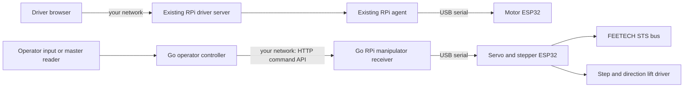

# Architecture and protocol

The driver server, agent and camera implementation are copied intact under `driver/`, including their deployment settings. Start those programs using your existing configuration. The new manipulator service never opens the motor device or camera and never modifies the driver routes or UI.

## USB packet framing

Every packet is `3f 24 TYPE LEN_LO LEN_HI PAYLOAD...` (`?$` header), maximum payload 256 bytes. All multibyte numbers are little endian. There is no checksum, matching the upstream protocol. The complete pose batch is validated before any servo target is transmitted.

| Type | Request payload | Reply |
| --- | --- | --- |
| `10` | u16 speed, u16 acceleration, then 1..12 `(u8 ID, u16 normalized position)` records | ACK |
| `11` | 1..12 servo IDs | `12`: u16 normalized positions, same order |
| `20` | `64` (`d`) for upstream operator reader | `21`: six button bytes |
| `30` | u16 mm down from upper zero | ACK |
| `31` | empty: enable lift holding power | ACK |
| `32` | empty: stop and disable lift; invalidate homing | ACK |
| `33` | empty: home lift to upper switch | ACK |
| `34` | empty: read lift state | `35`: i32 signed steps, u8 flags, u8 fault |
| `36` | empty: immediate lift stop, retain holding power | ACK |
| `37` | empty: control heartbeat | ACK |
| `48` | empty: switch robot firmware to text mode | ACK |
| `7e` | reply only: request type, error code | — |

Types shown above are hexadecimal. Lift flag bits 0..5: homed, homing, enabled, moving, top switch pressed, bottom switch pressed. The step count is negative below the upper zero; mm down = `-steps / STEPS_PER_MM`.

Error codes: 0 accepted, 1 malformed/unsupported command, 2 range or duplicate ID, 3 lift not enabled/homed or currently homing, 4 conflicting or blocking endstop, 9 missing servo calibration, 10 failed servo read. Lift status faults: 4 both switches pressed, 5 control timeout, 6 homing travel/time exhausted, 7 upper switch stopped ordinary motion, 8 lower switch stopped motion.

ACK means the firmware accepted the command; synchronous servo writes do not prove that the servos reached their targets. HTTP errors never trigger automatic movement retries. A valid firmware rejection preserves the current serial connection; an uncertain or malformed serial exchange closes it. The next request may reopen the port (which can reset an ESP32), but no prior movement command is replayed.

## Timing and failure behavior

The operator sends heartbeats every 200ms while running. The firmware checks the 750ms control lease and directional endstops from a separate ESP timer task with a requested 50µs tick period. A lost lease stops the lift immediately and retains holding power. Servo targets retain their ordinary holding behavior; this is not a servo emergency stop.

No motion or homing starts on boot. Opening an ESP32 USB port can reset it, so Go waits 1.5s before sending packets. Go serial transactions have a 3s overall deadline. Requests wait at most 150ms for a busy device, preventing a backlog of old commands. Reads, malformed packets, invalid commands and unrelated HTTP traffic do not renew the firmware lift lease. Only accepted servo target batches, lift movement/calibration commands and explicit heartbeats do.

Firmware zero-length commands are handled immediately. Partial frames time out after a 100ms gap between bytes. Oversized frames are rejected and discarded. Commissioning operations that access flash are blocked while the lift is moving.

The original operator reader firmware is included verbatim as a reference under `firmware/upstream/servo-control/esp_reader_low_level/`; it runs on an operator-side device if you use a physical master manipulator. The two ESP32 requirement refers to the robot itself. JSON input does not need an operator-side ESP32. Its button protocol is supported by the Go serial package; the stock forwarding command polls poses only and never maps buttons to robot driving or lift movement automatically.

## Motor power pulse

The driver control WebSocket also accepts `{"type":"power_pulse"}`. The server forwards this event once to its connected agent; the agent reports immediate `power_result` feedback and includes `powerStatus` in ordinary status updates. The camera signaling and media paths are unchanged.

The motor agent serial writer owns both ordinary velocity lines and the exact `POWER_PULSE\n` command. Pending relay requests expire after 250ms, are cleared on disconnection, and are consumed before serial transmission. A failed or partial write has an uncertain physical outcome and is never replayed. Accepted requests are rate limited to one per two seconds, with a three-second frontend cooldown. Firmware feedback reports readiness, active pulse and completion; missing confirmation times out instead of claiming an on/off state.

On the motor ESP32, GPIO25 defaults to active high for 500ms. Configuration lives in `firmware/motor/esp32_dual_hover_uart/config.h`. An independent timer turns the output inactive, while the main loop continues wheel watchdog/feedback work. The relay starts inactive and does not pulse on initialization or reconnection. The same pulse operates the hardware power switch in either direction; actual power state remains unknown.
